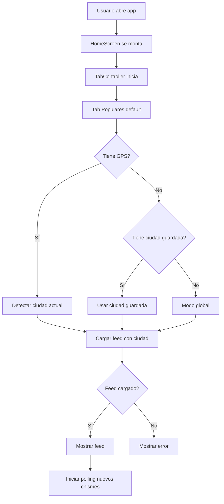
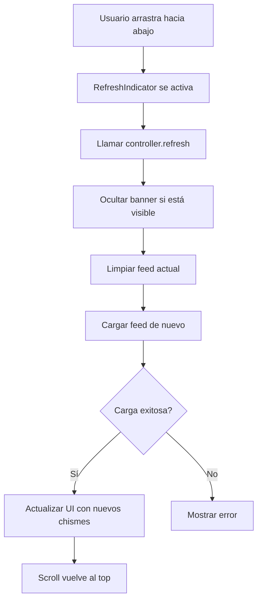
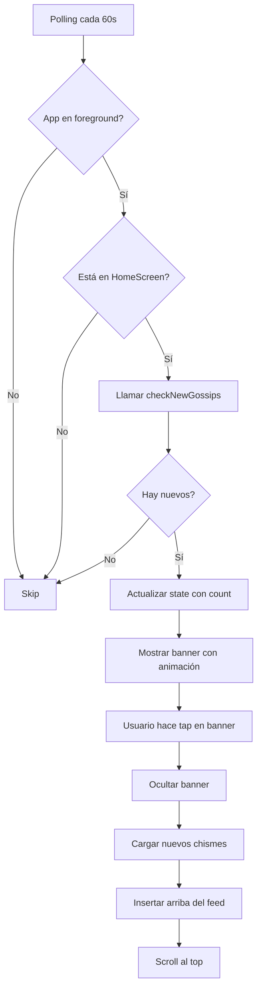
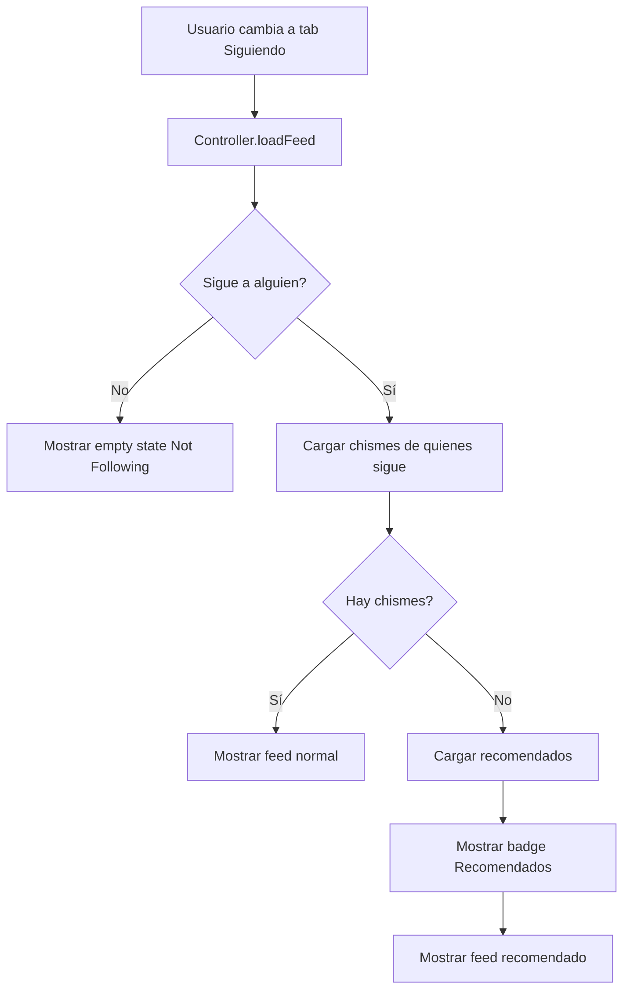

# Home Feed - Especificación Completa (Ideal)

**Versión:** 1.0  
**Fecha:** 2026-11-04  
**Autor:** Alejo + Claude  
**Estado:** ✅ Aprobado para implementación

---

## 📋 ÍNDICE

1. [Resumen Ejecutivo](#resumen-ejecutivo)
2. [Arquitectura General](#arquitectura-general)
3. [Tab 1: Populares 🔥](#tab-1-populares)
4. [Tab 2: Siguiendo ❤️](#tab-2-siguiendo)
5. [Algoritmo de Ranking](#algoritmo-de-ranking)
6. [Sistema de Actualización (Híbrido)](#sistema-de-actualización-híbrido)
7. [Mix de Ciudades (70/20/10)](#mix-de-ciudades-702010)
8. [Especificación de UI/UX](#especificación-de-uiux)
9. [Arquitectura Técnica](#arquitectura-técnica)
10. [Queries y Backend](#queries-y-backend)
11. [Estados y Flujos](#estados-y-flujos)
12. [Traducciones i18n](#traducciones-i18n)
13. [Testing](#testing)
14. [Estimación y Fases](#estimación-y-fases)

---

## 1. RESUMEN EJECUTIVO

### Objetivo
Crear un **Home Feed de 2 tabs** (Populares + Siguiendo) con:
- ✅ Algoritmo de ranking multi-factor
- ✅ Sistema híbrido de actualización (Pull-to-refresh + Banner)
- ✅ Mix inteligente 70/20/10 de ciudades
- ✅ Fallback automático en tab Siguiendo
- ✅ UX de clase mundial (Instagram/Twitter level)

### Decisiones Clave Aprobadas

| Aspecto | Decisión |
|---------|----------|
| **Tab default** | Populares 🔥 |
| **Header** | "Descubre" (ajustable) |
| **Actualización** | Híbrido (Pull + Banner) |
| **Mix ciudades** | 70/20/10 con badge visible |
| **Siguiendo vacío** | Fallback a "Recomendados para ti" |
| **Algoritmo** | Multi-factor (likes, comments, velocity, decay, ciudad) |

---

## 2. ARQUITECTURA GENERAL

```
┌─────────────────────────────────────────────────────┐
│                   HOME SCREEN                       │
│                                                     │
│  AppBar: "Descubre 👀"                              │
│                                                     │
│  ┌──────────────┬──────────────┐                   │
│  │ Populares 🔥 │ Siguiendo ❤️ │  ← TabBar         │
│  └──────────────┴──────────────┘                   │
│                                                     │
│  ┌─────────────────────────────────────────────┐   │
│  │ 🔥 3 nuevos chismes · Tap aquí             │   │ ← Banner (opcional)
│  └─────────────────────────────────────────────┘   │
│                                                     │
│  ┌─────────────────────────────────────────────┐   │
│  │ CONTENIDO DEL TAB ACTIVO                    │   │
│  │                                             │   │
│  │ [GossipCard 1]                              │   │
│  │ [GossipCard 2]                              │   │
│  │ [GossipCard 3]                              │   │
│  │ ...                                         │   │
│  └─────────────────────────────────────────────┘   │
│                                                     │
└─────────────────────────────────────────────────────┘
│  🏠  🔍  ➕  👤                                     │  ← BottomNav
└─────────────────────────────────────────────────────┘
```

### Componentes Principales

```
HomeScreen
├── AppBar ("Descubre")
├── TabBar (Populares / Siguiendo)
├── NewGossipsBanner (condicional)
├── TabBarView
│   ├── PopularTab
│   │   ├── PopularTabController
│   │   ├── LocationHeader (dinámico)
│   │   └── GossipList
│   └── FollowingTab
│       ├── FollowingTabController
│       ├── FallbackBanner (si vacío)
│       └── GossipList (Following o Recommended)
└── RefreshIndicator (ambos tabs)
```

---

## 3. TAB 1: POPULARES 🔥

### 3.1 Comportamiento

**Default:** Tab que aparece al abrir la app.

**Objetivo:** Mostrar los chismes más relevantes para el usuario según:
1. Su ubicación (ciudad)
2. Interacciones (likes, comments, shares)
3. Velocidad de crecimiento (trending)
4. Frescura (recientes vs antiguos)

### 3.2 Header Dinámico

```
┌─────────────────────────────────────┐
│ 📍 Popular en Medellín              │  ← Con GPS/Ciudad guardada
└─────────────────────────────────────┘

┌─────────────────────────────────────┐
│ 🌎 Popular en el mundo              │  ← Sin GPS ni ciudad guardada
└─────────────────────────────────────┘
```

**Lógica:**
```dart
String getPopularHeaderText() {
  // 1. Intentar GPS
  if (hasGPSPermission && currentCity != null) {
    return 'popular_in_city'.tr(namedArgs: {'city': currentCity.name});
  }
  
  // 2. Intentar ciudad guardada
  if (savedCity != null) {
    return 'popular_in_city'.tr(namedArgs: {'city': savedCity.name});
  }
  
  // 3. Fallback a global
  return 'popular_global'.tr();
}
```

### 3.3 Contenido

**Feed de chismes ordenados por Score (ver sección 5: Algoritmo)**

**Mix de ciudades:** 70/20/10 (ver sección 7)

**Cards:**
- Mostrar badge `[Ciudad]` solo si el chisme es de **otra ciudad**
- Ejemplo:
  ```
  Usuario está en Medellín:
  - Chisme de Medellín → NO mostrar badge
  - Chisme de Bogotá → Mostrar [Bogotá] 🔥
  ```

### 3.4 Pull-to-Refresh

✅ Disponible siempre  
✅ Recarga feed completo  
✅ Animación estándar de Flutter (`RefreshIndicator`)

### 3.5 Banner "Nuevos Chismes"

✅ Aparece si hay chismes nuevos mientras el usuario scrollea  
✅ Sticky en top del feed  
✅ Desaparece al hacer tap o al hacer pull-to-refresh  
✅ Polling cada 60 segundos (solo si app en foreground)

---

## 4. TAB 2: SIGUIENDO ❤️

### 4.1 Comportamiento

**Objetivo:** Mostrar chismes de las personas que el usuario sigue.

**Ordenamiento:** Más recientes primero (orden cronológico inverso).

### 4.2 Casos

#### **Caso 1: Hay Chismes de Personas que Sigo**

```
┌─────────────────────────────────────┐
│ Tab: Siguiendo ❤️                   │
│                                     │
│ [Chisme de @juan - Hace 5 min]      │
│ [Chisme de @maria - Hace 1h]        │
│ [Chisme de @carlos - Ayer]          │
│ ...                                 │
└─────────────────────────────────────┘
```

**Feed normal:** Mostrar chismes de quienes sigo, ordenados por `created_at DESC`.

---

#### **Caso 2: NO Hay Chismes (pero sigo a gente)**

```
┌─────────────────────────────────────┐
│ Tab: Siguiendo ❤️                   │
│                                     │
│ ┌───────────────────────────────┐   │
│ │ 💡 Recomendados para ti       │   │  ← Badge discreto
│ └───────────────────────────────┘   │
│                                     │
│ [Chisme recomendado 1]              │
│ [Chisme recomendado 2]              │
│ [Chisme recomendado 3]              │
│ ...                                 │
│                                     │
│ ┌───────────────────────────────┐   │
│ │ 💬 Las personas que sigues    │   │
│ │    aún no han publicado nada. │   │  ← Banner inferior (opcional)
│ └───────────────────────────────┘   │
└─────────────────────────────────────┘
```

**Fallback automático:**
- Badge en top: "💡 Recomendados para ti"
- Mostrar chismes populares/trending (mismo algoritmo que tab Populares)
- Banner explicativo en bottom (opcional)

---

#### **Caso 3: NO Sigo a Nadie**

```
┌─────────────────────────────────────┐
│ Tab: Siguiendo ❤️                   │
│                                     │
│            🌙                       │
│                                     │
│   Aún no sigues a nadie             │
│                                     │
│   Descubre personas interesantes    │
│   y sigue sus historias.            │
│                                     │
│   ┌───────────────────────────┐     │
│   │ 🔍 Explorar usuarios      │     │  ← CTA principal
│   └───────────────────────────┘     │
│                                     │
│   o                                 │
│                                     │
│   👉 Ver Populares                  │  ← Link secundario
└─────────────────────────────────────┘
```

**Empty state especial:**
- Icono amigable (🌙 o 👥)
- Mensaje claro
- CTA principal: "Explorar usuarios" (va a pantalla de búsqueda/sugeridos)
- CTA secundario: "Ver Populares" (cambia a tab Populares)

### 4.3 Pull-to-Refresh

✅ Disponible siempre  
✅ Recarga feed (o recomendados si no hay)

### 4.4 Banner "Nuevos Chismes"

✅ Igual que tab Populares  
✅ Solo si hay nuevos chismes de quienes sigo

---

## 5. ALGORITMO DE RANKING

### 5.1 Fórmula Maestra

```javascript
score_final = (
  score_ciudad * 0.40 +           // 40% peso a proximidad geográfica
  score_interacciones * 0.30 +    // 30% peso a popularidad
  score_velocity * 0.20 +         // 20% peso a trending
  score_decay * 0.10              // 10% peso a frescura
)
```

### 5.2 Componentes del Score

#### **A. Score de Ciudad**

```sql
score_ciudad = CASE
  WHEN gossip.city_id = user.city_id THEN 100      -- Mi ciudad
  WHEN gossip.is_trending_national THEN 50         -- Trending nacional
  ELSE 20                                          -- Otras ciudades
END
```

**Explicación:**
- Chisme de **mi ciudad**: Score máximo (100)
- Chisme **viral nacional**: Score medio (50)
- Chisme de **otra ciudad**: Score bajo (20)

**Nota:** Un chisme de otra ciudad puede superar a uno local si tiene suficientes interacciones.

---

#### **B. Score de Interacciones**

```sql
score_interacciones = (
  likes * 1.0 +
  comments * 2.0 +      -- Comentarios valen más (más engagement)
  shares * 3.0          -- Shares valen aún más (viralidad)
)
```

**Pesos:**
- **Like:** 1 punto
- **Comment:** 2 puntos (requiere más esfuerzo)
- **Share:** 3 puntos (amplifica alcance)

**Ejemplo:**
- Chisme con 100 likes, 20 comments, 5 shares:
  - `score = 100*1 + 20*2 + 5*3 = 155`

---

#### **C. Score de Velocity (Trending)**

```sql
score_velocity = (total_interactions) / (hours_since_published + 1)
```

**Explicación:**
- Mide la **velocidad de crecimiento** de interacciones
- Chismes que explotan rápidamente tienen score alto
- El `+1` evita división por cero

**Ejemplo:**
- Chisme A: 100 interacciones en 2 horas → `velocity = 100 / 3 = 33.3`
- Chisme B: 200 interacciones en 48 horas → `velocity = 200 / 49 = 4.1`

**Resultado:** Chisme A (más reciente) tiene mayor velocity score.

---

#### **D. Score de Decay (Frescura)**

```sql
score_decay = 1 / (1 + hours_since_published * 0.05)
```

**Explicación:**
- Penaliza chismes antiguos
- Pero no los elimina (un chisme muy popular puede seguir arriba)

**Valores:**
- Chisme de 1 hora: `decay = 1 / (1 + 1*0.05) = 0.95`
- Chisme de 10 horas: `decay = 1 / (1 + 10*0.05) = 0.67`
- Chisme de 48 horas: `decay = 1 / (1 + 48*0.05) = 0.29`

---

### 5.3 Threshold para Virales de Otras Ciudades

Un chisme de **otra ciudad** aparece en tu feed solo si:

```sql
-- Condición: Es viral
(score_interacciones > 500 AND score_velocity > 10) OR
(likes > 1000) OR
(shares > 100) OR
(comments > 200)
```

**Si no cumple:** No aparece (se queda en su ciudad).

---

### 5.4 Ejemplo Completo

**Escenario:**
- Usuario en **Medellín**
- Chisme A de **Medellín**: 50 likes, 10 comments, 2 shares, 3 horas de antigüedad
- Chisme B de **Pasto**: 1,200 likes, 300 comments, 120 shares, 5 horas de antigüedad

**Cálculo Chisme A (Medellín):**
```
score_ciudad = 100 (mi ciudad)
score_interacciones = 50*1 + 10*2 + 2*3 = 76
score_velocity = 76 / (3+1) = 19
score_decay = 1 / (1 + 3*0.05) = 0.87

score_final = 100*0.4 + 76*0.3 + 19*0.2 + 0.87*0.1
            = 40 + 22.8 + 3.8 + 0.087
            = 66.69
```

**Cálculo Chisme B (Pasto):**
```
score_ciudad = 20 (otra ciudad, pero viral)
score_interacciones = 1200*1 + 300*2 + 120*3 = 2,160
score_velocity = 2160 / (5+1) = 360
score_decay = 1 / (1 + 5*0.05) = 0.80

score_final = 20*0.4 + 2160*0.3 + 360*0.2 + 0.80*0.1
            = 8 + 648 + 72 + 0.08
            = 728.08
```

**Resultado:** El chisme viral de Pasto (728.08) **supera** al chisme local de Medellín (66.69).

✅ **Aparece en el feed** con badge `[Pasto] 🔥 Trending`

---

## 6. SISTEMA DE ACTUALIZACIÓN (HÍBRIDO)

### 6.1 Pull-to-Refresh

**Disponible:** Siempre en ambos tabs.

**Comportamiento:**
1. Usuario arrastra hacia abajo
2. Aparece indicador de loading
3. Se llama `refresh()` en el controller
4. Feed se recarga completo
5. Scroll vuelve al top

**Implementación:**
```dart
RefreshIndicator(
  onRefresh: () async {
    await controller.refresh();
  },
  child: ListView.builder(...),
)
```

---

### 6.2 Banner "Nuevos Chismes"

**Condición:** Solo aparece si hay chismes nuevos mientras el usuario está en el feed.

**Ubicación:** Sticky en top del feed (encima de la primera card).

**Diseño:**
```
┌─────────────────────────────────────┐
│ 🔥 3 nuevos chismes · Tap aquí     │  ← Banner animado
└─────────────────────────────────────┘
```

**Comportamiento:**
1. **Polling cada 60 segundos** (solo si app en foreground y en home screen)
2. Si hay nuevos chismes → Banner aparece con animación fade-in
3. Usuario hace tap → Se insertan nuevos chismes arriba + scroll al top + banner desaparece
4. Usuario hace pull-to-refresh → Banner desaparece (ya se recargó todo)
5. Usuario cambia de tab → Banner desaparece

**Lógica de Polling:**
```dart
Timer? _pollingTimer;

void startPolling() {
  _pollingTimer = Timer.periodic(Duration(seconds: 60), (_) async {
    if (!_isAppInForeground || !_isOnHomeScreen) return;
    
    final newGossips = await _checkForNewGossips();
    
    if (newGossips.isNotEmpty) {
      _showBanner(newGossips.length);
    }
  });
}

void stopPolling() {
  _pollingTimer?.cancel();
  _pollingTimer = null;
}
```

**Optimización de batería:**
- Polling solo si app en foreground
- Polling solo si está en home screen
- Cancelar polling al salir del home

---

### 6.3 Estado del Banner

```dart
enum BannerState {
  hidden,      // No hay nuevos chismes
  visible,     // Hay nuevos, mostrando banner
  loading,     // Usuario hizo tap, cargando nuevos
}
```

---

## 7. MIX DE CIUDADES (70/20/10)

### 7.1 Estrategia

```
70% → Chismes de MI ciudad
20% → Chismes trending de OTRAS ciudades (virales)
10% → Chismes globales destacados
```

### 7.2 Implementación en Query

```sql
-- Query para feed Populares
WITH ranked_gossips AS (
  SELECT 
    g.*,
    -- Score de ciudad
    CASE
      WHEN g.city_id = $user_city_id THEN 100
      WHEN g.is_trending_national THEN 50
      ELSE 20
    END AS score_ciudad,
    
    -- Score de interacciones
    (g.likes * 1.0 + g.comments * 2.0 + g.shares * 3.0) AS score_interacciones,
    
    -- Score de velocity
    (g.likes + g.comments + g.shares) / (EXTRACT(EPOCH FROM (NOW() - g.created_at)) / 3600 + 1) AS score_velocity,
    
    -- Score de decay
    1.0 / (1.0 + (EXTRACT(EPOCH FROM (NOW() - g.created_at)) / 3600) * 0.05) AS score_decay,
    
    -- Score final
    (
      CASE WHEN g.city_id = $user_city_id THEN 100 ELSE 20 END * 0.4 +
      (g.likes * 1.0 + g.comments * 2.0 + g.shares * 3.0) * 0.3 +
      ((g.likes + g.comments + g.shares) / (EXTRACT(EPOCH FROM (NOW() - g.created_at)) / 3600 + 1)) * 0.2 +
      (1.0 / (1.0 + (EXTRACT(EPOCH FROM (NOW() - g.created_at)) / 3600) * 0.05)) * 0.1
    ) AS score_final
    
  FROM gossips g
  WHERE 
    g.status = 'published' AND
    g.moderation_status = 'approved' AND
    -- Filtro: Virales de otras ciudades deben cumplir threshold
    (
      g.city_id = $user_city_id OR
      g.likes > 1000 OR
      g.comments > 200 OR
      g.shares > 100 OR
      (g.likes + g.comments + g.shares) > 500
    )
)

SELECT *
FROM ranked_gossips
ORDER BY score_final DESC
LIMIT 50;
```

### 7.3 Badge de Ciudad

**Mostrar solo si:** `gossip.city_id != user.city_id`

**Diseño:**
```
┌────────────────────────────────────┐
│ Usuario anónimo                    │
│ [Pasto] · Hace 2h · 🔥 Trending    │  ← Badge
│                                    │
│ No van a creer lo que pasó...      │
│ ❤️ 1,234 · 💬 456                  │
└────────────────────────────────────┘
```

**Implementación:**
```dart
Widget _buildLocationBadge() {
  if (gossip.city.id == currentUser.city?.id) {
    return SizedBox.shrink(); // No mostrar si es mi ciudad
  }
  
  return Container(
    padding: EdgeInsets.symmetric(horizontal: 8, vertical: 4),
    decoration: BoxDecoration(
      color: Colors.orange.shade100,
      borderRadius: BorderRadius.circular(12),
    ),
    child: Text(
      gossip.city.name,
      style: TextStyle(
        fontSize: 12,
        fontWeight: FontWeight.w600,
        color: Colors.orange.shade900,
      ),
    ),
  );
}
```

---

## 8. ESPECIFICACIÓN DE UI/UX

### 8.1 HomeScreen

```dart
class HomeScreen extends StatefulWidget {
  @override
  Widget build(BuildContext context) {
    return DefaultTabController(
      length: 2,
      child: Scaffold(
        appBar: AppBar(
          title: Text('Descubre 👀'),
          bottom: TabBar(
            tabs: [
              Tab(icon: Icon(Icons.local_fire_department), text: 'Populares'),
              Tab(icon: Icon(Icons.favorite), text: 'Siguiendo'),
            ],
          ),
        ),
        body: TabBarView(
          children: [
            PopularTab(),
            FollowingTab(),
          ],
        ),
      ),
    );
  }
}
```

### 8.2 PopularTab

```dart
class PopularTab extends StatefulWidget {
  @override
  State<PopularTab> createState() => _PopularTabState();
}

class _PopularTabState extends State<PopularTab> {
  late PopularTabController _controller;
  
  @override
  void initState() {
    super.initState();
    _controller = getIt<PopularTabController>();
    _controller.loadFeed();
  }
  
  @override
  Widget build(BuildContext context) {
    return RefreshIndicator(
      onRefresh: () => _controller.refresh(),
      child: CustomScrollView(
        slivers: [
          // Header dinámico
          SliverToBoxAdapter(
            child: _buildLocationHeader(),
          ),
          
          // Banner "Nuevos chismes" (condicional)
          if (_controller.hasNewGossips)
            SliverToBoxAdapter(
              child: NewGossipsBanner(
                count: _controller.newGossipsCount,
                onTap: () => _controller.loadNewGossips(),
              ),
            ),
          
          // Lista de chismes
          ListenableBuilder(
            listenable: _controller,
            builder: (context, _) {
              if (_controller.isLoading) {
                return SliverFillRemaining(
                  child: Center(child: CircularProgressIndicator()),
                );
              }
              
              if (_controller.gossips.isEmpty) {
                return SliverFillRemaining(
                  child: EmptyStateWidget(
                    message: 'No hay chismes disponibles',
                  ),
                );
              }
              
              return SliverList(
                delegate: SliverChildBuilderDelegate(
                  (context, index) {
                    // ⭐ NUEVO: Detectar cuando llega al final
                    if (index == _controller.gossips.length - 3) {
                      // Cargar más cuando faltan 3 items
                      _controller.loadMore();
                    }
                    
                    return GossipCard(
                      gossip: _controller.gossips[index],
                      showCityBadge: _shouldShowCityBadge(index),
                    );
                  },
                  childCount: _controller.gossips.length,
                ),
              );
            },
          ),
          
          // ⭐ NUEVO: Loading indicator al final
          if (_controller.isLoadingMore)
            SliverToBoxAdapter(
              child: Padding(
                padding: EdgeInsets.all(16),
                child: Center(
                  child: CircularProgressIndicator(),
                ),
              ),
            ),
          
          // ⭐ NUEVO: Mensaje "No hay más" al final
          if (!_controller.hasMore && _controller.gossips.isNotEmpty)
            SliverToBoxAdapter(
              child: Padding(
                padding: EdgeInsets.all(24),
                child: Center(
                  child: Text(
                    'No hay más chismes por ahora 🌙',
                    style: TextStyle(color: Colors.grey),
                  ),
                ),
              ),
            );
            },
          ),
        ],
      ),
    );
  }
  
  Widget _buildLocationHeader() {
    final headerText = _controller.getLocationHeaderText();
    return Padding(
      padding: EdgeInsets.all(16),
      child: Text(
        headerText,
        style: TextStyle(
          fontSize: 16,
          fontWeight: FontWeight.w600,
        ),
      ),
    );
  }
  
  bool _shouldShowCityBadge(int index) {
    final gossip = _controller.gossips[index];
    final userCity = _controller.currentUser?.city;
    return gossip.city.id != userCity?.id;
  }
}
```

### 8.3 FollowingTab

```dart
class FollowingTab extends StatefulWidget {
  @override
  State<FollowingTab> createState() => _FollowingTabState();
}

class _FollowingTabState extends State<FollowingTab> {
  late FollowingTabController _controller;
  
  @override
  void initState() {
    super.initState();
    _controller = getIt<FollowingTabController>();
    _controller.loadFeed();
  }
  
  @override
  Widget build(BuildContext context) {
    return RefreshIndicator(
      onRefresh: () => _controller.refresh(),
      child: ListenableBuilder(
        listenable: _controller,
        builder: (context, _) {
          // Caso 1: Loading
          if (_controller.isLoading) {
            return Center(child: CircularProgressIndicator());
          }
          
          // Caso 2: No sigue a nadie
          if (_controller.followingCount == 0) {
            return _buildEmptyStateNotFollowing();
          }
          
          // Caso 3: Sigue a gente pero no hay chismes
          if (_controller.gossips.isEmpty) {
            return _buildFallbackRecommended();
          }
          
          // Caso 4: Hay chismes
          return _buildFeedList();
        },
      ),
    );
  }
  
  Widget _buildEmptyStateNotFollowing() {
    return Center(
      child: Padding(
        padding: EdgeInsets.all(32),
        child: Column(
          mainAxisAlignment: MainAxisAlignment.center,
          children: [
            Icon(Icons.people_outline, size: 80, color: Colors.grey),
            SizedBox(height: 24),
            Text(
              'Aún no sigues a nadie',
              style: Theme.of(context).textTheme.headlineSmall,
            ),
            SizedBox(height: 12),
            Text(
              'Descubre personas interesantes y sigue sus historias',
              textAlign: TextAlign.center,
              style: TextStyle(color: Colors.grey),
            ),
            SizedBox(height: 32),
            ElevatedButton.icon(
              onPressed: () {
                // Navegar a pantalla de explorar usuarios
              },
              icon: Icon(Icons.search),
              label: Text('Explorar usuarios'),
            ),
            SizedBox(height: 16),
            TextButton(
              onPressed: () {
                // Cambiar a tab Populares
              },
              child: Text('Ver Populares'),
            ),
          ],
        ),
      ),
    );
  }
  
  Widget _buildFallbackRecommended() {
    return CustomScrollView(
      slivers: [
        // Banner "Recomendados para ti"
        SliverToBoxAdapter(
          child: Container(
            padding: EdgeInsets.all(16),
            margin: EdgeInsets.all(16),
            decoration: BoxDecoration(
              color: Colors.blue.shade50,
              borderRadius: BorderRadius.circular(12),
            ),
            child: Row(
              children: [
                Icon(Icons.lightbulb_outline, color: Colors.blue),
                SizedBox(width: 12),
                Text(
                  'Recomendados para ti',
                  style: TextStyle(
                    fontWeight: FontWeight.w600,
                    color: Colors.blue.shade900,
                  ),
                ),
              ],
            ),
          ),
        ),
        
        // Lista de chismes recomendados
        SliverList(
          delegate: SliverChildBuilderDelegate(
            (context, index) => GossipCard(
              gossip: _controller.recommendedGossips[index],
            ),
            childCount: _controller.recommendedGossips.length,
          ),
        ),
        
        // Banner inferior explicativo
        SliverToBoxAdapter(
          child: Padding(
            padding: EdgeInsets.all(16),
            child: Text(
              '💬 Las personas que sigues aún no han publicado nada',
              textAlign: TextAlign.center,
              style: TextStyle(color: Colors.grey),
            ),
          ),
        ),
      ],
    );
  }
  
  Widget _buildFeedList() {
    return ListView.builder(
      itemCount: _controller.gossips.length,
      itemBuilder: (context, index) => GossipCard(
        gossip: _controller.gossips[index],
      ),
    );
  }
}
```

### 8.4 NewGossipsBanner

```dart
class NewGossipsBanner extends StatelessWidget {
  final int count;
  final VoidCallback onTap;
  
  const NewGossipsBanner({
    required this.count,
    required this.onTap,
  });
  
  @override
  Widget build(BuildContext context) {
    return Padding(
      padding: EdgeInsets.symmetric(horizontal: 16, vertical: 8),
      child: Material(
        color: Theme.of(context).colorScheme.primaryContainer,
        borderRadius: BorderRadius.circular(24),
        child: InkWell(
          onTap: onTap,
          borderRadius: BorderRadius.circular(24),
          child: Padding(
            padding: EdgeInsets.symmetric(horizontal: 20, vertical: 12),
            child: Row(
              mainAxisAlignment: MainAxisAlignment.center,
              children: [
                Icon(
                  Icons.local_fire_department,
                  color: Theme.of(context).colorScheme.onPrimaryContainer,
                ),
                SizedBox(width: 8),
                Text(
                  '$count nuevos chismes · Tap aquí',
                  style: TextStyle(
                    fontWeight: FontWeight.w600,
                    color: Theme.of(context).colorScheme.onPrimaryContainer,
                  ),
                ),
              ],
            ),
          ),
        ),
      ),
    );
  }
}
```

---

## 9. ARQUITECTURA TÉCNICA

### 9.1 Feature Structure

```
lib/features/home/
├── data/
│   ├── datasources/
│   │   └── home_remote_datasource.dart
│   ├── models/
│   │   ├── popular_feed_model.dart
│   │   └── following_feed_model.dart
│   └── repositories/
│       └── home_repository_impl.dart
│
├── domain/
│   ├── entities/
│   │   ├── feed_gossip.dart            # Gossip + metadata (score, is_from_my_city, etc.)
│   │   └── feed_config.dart            # Config del feed (city, filters, etc.)
│   ├── repositories/
│   │   └── home_repository.dart
│   └── usecases/
│       ├── get_popular_feed.dart
│       ├── get_following_feed.dart
│       ├── get_recommended_feed.dart
│       └── check_new_gossips.dart
│
└── presentation/
    ├── controllers/
    │   ├── popular_tab_controller.dart
    │   └── following_tab_controller.dart
    ├── screens/
    │   └── home_screen.dart
    ├── widgets/
    │   ├── popular_tab.dart
    │   ├── following_tab.dart
    │   ├── new_gossips_banner.dart
    │   ├── empty_state_not_following.dart
    │   └── fallback_recommended_banner.dart
    └── states/
        ├── popular_tab_state.dart
        └── following_tab_state.dart
```

### 9.2 Domain Layer

#### **Entity: FeedGossip**

```dart
class FeedGossip extends Equatable {
  final String id;
  final String subject;
  final String content;
  final City city;
  final DateTime createdAt;
  final int likes;
  final int comments;
  final int shares;
  final bool isAnonymous;
  final String? authorId;
  final String? imageUrl;
  
  // Metadata para UI
  final double score;           // Score final del algoritmo
  final bool isFromMyCity;      // Para saber si mostrar badge
  final bool isTrending;        // Para mostrar badge "Trending"
  
  const FeedGossip({
    required this.id,
    required this.subject,
    required this.content,
    required this.city,
    required this.createdAt,
    required this.likes,
    required this.comments,
    required this.shares,
    required this.isAnonymous,
    this.authorId,
    this.imageUrl,
    required this.score,
    required this.isFromMyCity,
    required this.isTrending,
  });
  
  @override
  List<Object?> get props => [
    id,
    subject,
    content,
    city,
    createdAt,
    likes,
    comments,
    shares,
    isAnonymous,
    authorId,
    imageUrl,
    score,
    isFromMyCity,
    isTrending,
  ];
}
```

#### **Use Case: GetPopularFeed**

```dart
@injectable
class GetPopularFeed {
  final HomeRepository _repository;
  
  GetPopularFeed(this._repository);
  
  Future<Result<Failure, List<FeedGossip>>> call({
    required String? userId,
    required String? cityId,
    int limit = 50,
  }) async {
    return await _repository.getPopularFeed(
      userId: userId,
      cityId: cityId,
      limit: limit,
    );
  }
}
```

#### **Use Case: GetFollowingFeed**

```dart
@injectable
class GetFollowingFeed {
  final HomeRepository _repository;
  
  GetFollowingFeed(this._repository);
  
  Future<Result<Failure, List<FeedGossip>>> call({
    required String userId,
    int limit = 50,
  }) async {
    return await _repository.getFollowingFeed(
      userId: userId,
      limit: limit,
    );
  }
}
```

#### **Use Case: GetRecommendedFeed**

```dart
@injectable
class GetRecommendedFeed {
  final HomeRepository _repository;
  
  GetRecommendedFeed(this._repository);
  
  Future<Result<Failure, List<FeedGossip>>> call({
    required String? userId,
    required String? cityId,
    int limit = 20,
  }) async {
    // Misma lógica que Popular pero con limit menor
    return await _repository.getPopularFeed(
      userId: userId,
      cityId: cityId,
      limit: limit,
    );
  }
}
```

#### **Use Case: CheckNewGossips**

```dart
@injectable
class CheckNewGossips {
  final HomeRepository _repository;
  
  CheckNewGossips(this._repository);
  
  Future<Result<Failure, int>> call({
    required String? userId,
    required String? cityId,
    required DateTime since,
  }) async {
    return await _repository.checkNewGossips(
      userId: userId,
      cityId: cityId,
      since: since,
    );
  }
}
```

### 9.3 Data Layer

#### **Remote DataSource**

```dart
@injectable
class HomeRemoteDataSource {
  final SupabaseClient _supabase;
  
  HomeRemoteDataSource(this._supabase);
  
  Future<List<FeedGossipModel>> getPopularFeed({
    required String? userId,
    required String? cityId,
    int limit = 50,
  }) async {
    try {
      // Query con algoritmo de ranking
      final response = await _supabase.rpc(
        'get_popular_feed',
        params: {
          'user_city_id': cityId,
          'feed_limit': limit,
        },
      );
      
      if (response == null) return [];
      
      return (response as List)
          .map((json) => FeedGossipModel.fromJson(json))
          .toList();
    } catch (e) {
      throw ServerException(message: e.toString());
    }
  }
  
  Future<List<FeedGossipModel>> getFollowingFeed({
    required String userId,
    int limit = 50,
  }) async {
    try {
      final response = await _supabase.rpc(
        'get_following_feed',
        params: {
          'current_user_id': userId,
          'feed_limit': limit,
        },
      );
      
      if (response == null) return [];
      
      return (response as List)
          .map((json) => FeedGossipModel.fromJson(json))
          .toList();
    } catch (e) {
      throw ServerException(message: e.toString());
    }
  }
  
  Future<int> checkNewGossips({
    required String? userId,
    required String? cityId,
    required DateTime since,
  }) async {
    try {
      final response = await _supabase.rpc(
        'check_new_gossips',
        params: {
          'user_city_id': cityId,
          'since_timestamp': since.toIso8601String(),
        },
      );
      
      return response as int;
    } catch (e) {
      throw ServerException(message: e.toString());
    }
  }
}
```

#### **Repository Implementation**

```dart
@Singleton(as: HomeRepository)
class HomeRepositoryImpl implements HomeRepository {
  final HomeRemoteDataSource _remoteDataSource;
  final AppLogger _logger;
  
  HomeRepositoryImpl(
    this._remoteDataSource,
    this._logger,
  );
  
  @override
  Future<Result<Failure, List<FeedGossip>>> getPopularFeed({
    required String? userId,
    required String? cityId,
    int limit = 50,
  }) async {
    try {
      _logger.d('Fetching popular feed', context: {
        'userId': userId,
        'cityId': cityId,
        'limit': limit,
      });
      
      final models = await _remoteDataSource.getPopularFeed(
        userId: userId,
        cityId: cityId,
        limit: limit,
      );
      
      final entities = models.map((m) => m.toEntity()).toList();
      
      _logger.i('Popular feed loaded', context: {
        'count': entities.length,
      });
      
      return Result.success(entities);
    } catch (error, stackTrace) {
      _logger.e('Failed to load popular feed',
        error: error,
        stackTrace: stackTrace,
      );
      return Result.failure(ErrorHandler.handleError(error));
    }
  }
  
  @override
  Future<Result<Failure, List<FeedGossip>>> getFollowingFeed({
    required String userId,
    int limit = 50,
  }) async {
    try {
      _logger.d('Fetching following feed', context: {
        'userId': userId,
        'limit': limit,
      });
      
      final models = await _remoteDataSource.getFollowingFeed(
        userId: userId,
        limit: limit,
      );
      
      final entities = models.map((m) => m.toEntity()).toList();
      
      _logger.i('Following feed loaded', context: {
        'count': entities.length,
      });
      
      return Result.success(entities);
    } catch (error, stackTrace) {
      _logger.e('Failed to load following feed',
        error: error,
        stackTrace: stackTrace,
      );
      return Result.failure(ErrorHandler.handleError(error));
    }
  }
  
  @override
  Future<Result<Failure, int>> checkNewGossips({
    required String? userId,
    required String? cityId,
    required DateTime since,
  }) async {
    try {
      final count = await _remoteDataSource.checkNewGossips(
        userId: userId,
        cityId: cityId,
        since: since,
      );
      
      return Result.success(count);
    } catch (error, stackTrace) {
      _logger.e('Failed to check new gossips',
        error: error,
        stackTrace: stackTrace,
      );
      return Result.failure(ErrorHandler.handleError(error));
    }
  }
}
```

### 9.4 Presentation Layer

#### **PopularTabController**

```dart
enum PopularTabState {
  initial,
  loading,
  loaded,
  error,
  loadingNew,
}

@injectable
class PopularTabController extends ChangeNotifier {
  final GetPopularFeed _getPopularFeed;
  final CheckNewGossips _checkNewGossips;
  final LocationService _locationService;
  final AppLogger _logger;
  
  PopularTabController(
    this._getPopularFeed,
    this._checkNewGossips,
    this._locationService,
    this._logger,
  );
  
  PopularTabState _state = PopularTabState.initial;
  List<FeedGossip> _gossips = [];
  String? _errorMessage;
  City? _currentCity;
  DateTime? _lastLoadTime;
  
  // ⭐ NUEVO: Paginación
  bool _hasMore = true;
  FeedCursor? _nextCursor;
  bool _isLoadingMore = false;
  
  // Banner de nuevos chismes
  bool _hasNewGossips = false;
  int _newGossipsCount = 0;
  Timer? _pollingTimer;
  
  // Getters
  PopularTabState get state => _state;
  List<FeedGossip> get gossips => _gossips;
  String? get errorMessage => _errorMessage;
  City? get currentCity => _currentCity;
  bool get isLoading => _state == PopularTabState.loading;
  bool get hasNewGossips => _hasNewGossips;
  int get newGossipsCount => _newGossipsCount;
  
  // ⭐ NUEVO: Getters de paginación
  bool get hasMore => _hasMore;
  bool get isLoadingMore => _isLoadingMore;
  
  String getLocationHeaderText() {
    if (_currentCity != null) {
      return 'Popular en ${_currentCity!.name}';
    }
    return 'Popular 🌎';
  }
  
  Future<void> loadFeed() async {
    _setState(PopularTabState.loading);
    
    try {
      // Obtener ciudad
      _currentCity = await _locationService.getDefaultLocation()
          .then((loc) => loc?.city);
      
      // Cargar feed
      final result = await _getPopularFeed(
        userId: null, // TODO: Get from AuthService
        cityId: _currentCity?.id,
      );
      
      result.fold(
        onFailure: (failure) {
          _errorMessage = failure.message;
          _setState(PopularTabState.error);
        },
        onSuccess: (gossips) {
          _gossips = gossips;
          _lastLoadTime = DateTime.now();
          _setState(PopularTabState.loaded);
          _startPolling();
        },
      );
    } catch (e) {
      _logger.e('Error loading popular feed', error: e);
      _errorMessage = e.toString();
      _setState(PopularTabState.error);
    }
  }
  
  Future<void> refresh() async {
    _hasNewGossips = false;
    _newGossipsCount = 0;
    _nextCursor = null;  // ⭐ NUEVO: Reset cursor
    _hasMore = true;
    await loadFeed();
  }
  
  // ⭐ NUEVO: Load more (infinite scroll)
  Future<void> loadMore() async {
    if (_isLoadingMore || !_hasMore) return;
    
    _isLoadingMore = true;
    notifyListeners();
    
    try {
      final result = await _getPopularFeed(
        userId: null,
        cityId: _currentCity?.id,
        pageSize: 20,
        cursor: _nextCursor,
      );
      
      result.fold(
        onFailure: (failure) {
          _logger.e('Error loading more gossips', error: failure);
          _isLoadingMore = false;
          notifyListeners();
        },
        onSuccess: (paginatedGossips) {
          _gossips.addAll(paginatedGossips.data);
          _hasMore = paginatedGossips.hasMore;
          _nextCursor = paginatedGossips.nextCursor;
          _isLoadingMore = false;
          notifyListeners();
        },
      );
    } catch (e) {
      _logger.e('Error loading more gossips', error: e);
      _isLoadingMore = false;
      notifyListeners();
    }
  }
  
  void _startPolling() {
    _pollingTimer?.cancel();
    
    _pollingTimer = Timer.periodic(Duration(seconds: 60), (_) async {
      await _checkForNewGossips();
    });
  }
  
  Future<void> _checkForNewGossips() async {
    if (_lastLoadTime == null) return;
    
    try {
      final result = await _checkNewGossips(
        userId: null,
        cityId: _currentCity?.id,
        since: _lastLoadTime!,
      );
      
      result.fold(
        onFailure: (_) {
          // Silently fail
        },
        onSuccess: (count) {
          if (count > 0) {
            _hasNewGossips = true;
            _newGossipsCount = count;
            notifyListeners();
          }
        },
      );
    } catch (e) {
      _logger.w('Error checking new gossips', error: e);
    }
  }
  
  Future<void> loadNewGossips() async {
    _setState(PopularTabState.loadingNew);
    _hasNewGossips = false;
    _newGossipsCount = 0;
    
    await loadFeed();
  }
  
  void _setState(PopularTabState newState) {
    _state = newState;
    notifyListeners();
  }
  
  @override
  void dispose() {
    _pollingTimer?.cancel();
    super.dispose();
  }
}
```

#### **FollowingTabController**

```dart
enum FollowingTabState {
  initial,
  loading,
  loaded,
  loadedRecommended,  // Fallback a recomendados
  notFollowing,       // No sigue a nadie
  error,
}

@injectable
class FollowingTabController extends ChangeNotifier {
  final GetFollowingFeed _getFollowingFeed;
  final GetRecommendedFeed _getRecommendedFeed;
  final AppLogger _logger;
  
  FollowingTabController(
    this._getFollowingFeed,
    this._getRecommendedFeed,
    this._logger,
  );
  
  FollowingTabState _state = FollowingTabState.initial;
  List<FeedGossip> _gossips = [];
  List<FeedGossip> _recommendedGossips = [];
  String? _errorMessage;
  int _followingCount = 0;
  
  // Getters
  FollowingTabState get state => _state;
  List<FeedGossip> get gossips => _gossips;
  List<FeedGossip> get recommendedGossips => _recommendedGossips;
  String? get errorMessage => _errorMessage;
  int get followingCount => _followingCount;
  bool get isLoading => _state == FollowingTabState.loading;
  
  Future<void> loadFeed() async {
    _setState(FollowingTabState.loading);
    
    try {
      // TODO: Get following count from ProfileService
      _followingCount = 5; // Placeholder
      
      // Caso 1: No sigue a nadie
      if (_followingCount == 0) {
        _setState(FollowingTabState.notFollowing);
        return;
      }
      
      // Caso 2: Cargar feed de quienes sigue
      final result = await _getFollowingFeed(
        userId: 'user-id', // TODO: Get from AuthService
      );
      
      result.fold(
        onFailure: (failure) {
          _errorMessage = failure.message;
          _setState(FollowingTabState.error);
        },
        onSuccess: (gossips) {
          _gossips = gossips;
          
          // Caso 3: Si no hay chismes, cargar recomendados
          if (_gossips.isEmpty) {
            _loadRecommended();
          } else {
            _setState(FollowingTabState.loaded);
          }
        },
      );
    } catch (e) {
      _logger.e('Error loading following feed', error: e);
      _errorMessage = e.toString();
      _setState(FollowingTabState.error);
    }
  }
  
  Future<void> _loadRecommended() async {
    try {
      final result = await _getRecommendedFeed(
        userId: null,
        cityId: null, // TODO: Get from LocationService
      );
      
      result.fold(
        onFailure: (failure) {
          _errorMessage = failure.message;
          _setState(FollowingTabState.error);
        },
        onSuccess: (gossips) {
          _recommendedGossips = gossips;
          _setState(FollowingTabState.loadedRecommended);
        },
      );
    } catch (e) {
      _logger.e('Error loading recommended feed', error: e);
      _setState(FollowingTabState.error);
    }
  }
  
  Future<void> refresh() async {
    await loadFeed();
  }
  
  void _setState(FollowingTabState newState) {
    _state = newState;
    notifyListeners();
  }
}
```

---

## 10. QUERIES Y BACKEND

### 10.0 Estrategia de Paginación ⭐ NUEVO

#### **Por qué Cursor-based Pagination**

**Problema con Offset:**
```sql
-- ❌ Lento con offsets grandes
SELECT * FROM gossips ORDER BY score DESC LIMIT 20 OFFSET 1000;
-- Problema: Sigue calculando las primeras 1000 filas aunque no las use
```

**Solución con Cursor:**
```sql
-- ✅ Rápido, siempre O(1)
SELECT * FROM gossips
WHERE (score, id) < ($last_score, $last_id)
ORDER BY score DESC, id DESC
LIMIT 20;
-- Problema: Solo busca desde el cursor, no calcula filas previas
```

#### **Parámetros de Paginación**

Todas las funciones de feed aceptan:
- `page_size`: Número de chismes por página (default: 20)
- `cursor_score`: Score del último chisme de la página anterior (NULL en primera carga)
- `cursor_id`: ID del último chisme de la página anterior (NULL en primera carga)

#### **Respuesta con Metadata**

Las funciones retornan:
```json
{
  "data": [...],  // Array de chismes
  "has_more": true,  // Si hay más páginas
  "next_cursor": {
    "score": 123.45,
    "id": "uuid"
  }
}
```

### 10.1 Supabase Function: get_popular_feed

```sql
-- Función: get_popular_feed
-- Parámetros:
--   user_city_id: UUID de la ciudad del usuario (puede ser NULL)
--   page_size: Número de chismes por página (default: 20)
--   cursor_score: Score del último chisme (NULL = primera página)
--   cursor_id: ID del último chisme (NULL = primera página)

CREATE OR REPLACE FUNCTION get_popular_feed(
  user_city_id UUID,
  page_size INT DEFAULT 20,
  cursor_score NUMERIC DEFAULT NULL,
  cursor_id UUID DEFAULT NULL
)
RETURNS TABLE (
  id UUID,
  subject TEXT,
  content TEXT,
  city_id UUID,
  city_name TEXT,
  city_country_id UUID,
  created_at TIMESTAMPTZ,
  likes INT,
  comments INT,
  shares INT,
  is_anonymous BOOLEAN,
  author_id UUID,
  image_url TEXT,
  score NUMERIC,
  is_from_my_city BOOLEAN,
  is_trending BOOLEAN
)
LANGUAGE plpgsql
AS $$
BEGIN
  RETURN QUERY
  WITH ranked_gossips AS (
    SELECT 
      g.id,
      g.subject,
      g.content,
      g.city_id,
      c.name AS city_name,
      c.country_id AS city_country_id,
      g.created_at,
      COALESCE(g.likes_count, 0) AS likes,
      COALESCE(g.comments_count, 0) AS comments,
      COALESCE(g.shares_count, 0) AS shares,
      g.is_anonymous,
      g.author_id,
      g.image_url,
      
      -- Score de ciudad
      CASE
        WHEN g.city_id = user_city_id THEN 100
        WHEN g.is_trending_national THEN 50
        ELSE 20
      END AS score_ciudad,
      
      -- Score de interacciones
      (
        COALESCE(g.likes_count, 0) * 1.0 +
        COALESCE(g.comments_count, 0) * 2.0 +
        COALESCE(g.shares_count, 0) * 3.0
      ) AS score_interacciones,
      
      -- Score de velocity (trending)
      (
        COALESCE(g.likes_count, 0) + 
        COALESCE(g.comments_count, 0) + 
        COALESCE(g.shares_count, 0)
      ) / (EXTRACT(EPOCH FROM (NOW() - g.created_at)) / 3600 + 1) AS score_velocity,
      
      -- Score de decay (frescura)
      1.0 / (1.0 + (EXTRACT(EPOCH FROM (NOW() - g.created_at)) / 3600) * 0.05) AS score_decay,
      
      -- Score final
      (
        CASE 
          WHEN g.city_id = user_city_id THEN 100 
          WHEN g.is_trending_national THEN 50
          ELSE 20 
        END * 0.4 +
        (
          COALESCE(g.likes_count, 0) * 1.0 +
          COALESCE(g.comments_count, 0) * 2.0 +
          COALESCE(g.shares_count, 0) * 3.0
        ) * 0.3 +
        (
          (COALESCE(g.likes_count, 0) + COALESCE(g.comments_count, 0) + COALESCE(g.shares_count, 0)) /
          (EXTRACT(EPOCH FROM (NOW() - g.created_at)) / 3600 + 1)
        ) * 0.2 +
        (1.0 / (1.0 + (EXTRACT(EPOCH FROM (NOW() - g.created_at)) / 3600) * 0.05)) * 0.1
      ) AS score_final,
      
      -- Metadata
      (g.city_id = user_city_id) AS is_from_my_city,
      (
        COALESCE(g.likes_count, 0) > 1000 OR
        COALESCE(g.comments_count, 0) > 200 OR
        COALESCE(g.shares_count, 0) > 100
      ) AS is_trending
      
    FROM gossips g
    INNER JOIN location_cities c ON g.city_id = c.id
    WHERE 
      g.status = 'published' AND
      g.moderation_status = 'approved' AND
      g.visibility = 'public' AND
      -- Filtro: Chismes de mi ciudad SIEMPRE aparecen
      -- Chismes de otras ciudades solo si son virales
      (
        g.city_id = user_city_id OR
        user_city_id IS NULL OR
        COALESCE(g.likes_count, 0) > 1000 OR
        COALESCE(g.comments_count, 0) > 200 OR
        COALESCE(g.shares_count, 0) > 100 OR
        (COALESCE(g.likes_count, 0) + COALESCE(g.comments_count, 0) + COALESCE(g.shares_count, 0)) > 500
      )
  )
  
  SELECT 
    rg.id,
    rg.subject,
    rg.content,
    rg.city_id,
    rg.city_name,
    rg.city_country_id,
    rg.created_at,
    rg.likes,
    rg.comments,
    rg.shares,
    rg.is_anonymous,
    rg.author_id,
    rg.image_url,
    rg.score_final AS score,
    rg.is_from_my_city,
    rg.is_trending
  FROM ranked_gossips rg
  WHERE 
    -- Paginación con cursor
    (cursor_score IS NULL OR 
     rg.score_final < cursor_score OR 
     (rg.score_final = cursor_score AND rg.id > cursor_id))
  ORDER BY rg.score_final DESC, rg.id ASC
  LIMIT page_size;
END;
$$;
```

### 10.2 Supabase Function: get_following_feed

```sql
-- Función: get_following_feed
-- Parámetros:
--   current_user_id: UUID del usuario actual
--   page_size: Número de chismes por página (default: 20)
--   cursor_created_at: created_at del último chisme (NULL = primera página)
--   cursor_id: ID del último chisme (NULL = primera página)

CREATE OR REPLACE FUNCTION get_following_feed(
  current_user_id UUID,
  page_size INT DEFAULT 20,
  cursor_created_at TIMESTAMPTZ DEFAULT NULL,
  cursor_id UUID DEFAULT NULL
)
RETURNS TABLE (
  id UUID,
  subject TEXT,
  content TEXT,
  city_id UUID,
  city_name TEXT,
  city_country_id UUID,
  created_at TIMESTAMPTZ,
  likes INT,
  comments INT,
  shares INT,
  is_anonymous BOOLEAN,
  author_id UUID,
  image_url TEXT,
  score NUMERIC,
  is_from_my_city BOOLEAN,
  is_trending BOOLEAN
)
LANGUAGE plpgsql
AS $$
BEGIN
  RETURN QUERY
  SELECT 
    g.id,
    g.subject,
    g.content,
    g.city_id,
    c.name AS city_name,
    c.country_id AS city_country_id,
    g.created_at,
    COALESCE(g.likes_count, 0) AS likes,
    COALESCE(g.comments_count, 0) AS comments,
    COALESCE(g.shares_count, 0) AS shares,
    g.is_anonymous,
    g.author_id,
    g.image_url,
    0::NUMERIC AS score,  -- No usamos score en Following
    TRUE AS is_from_my_city,  -- Placeholder
    FALSE AS is_trending  -- Placeholder
  FROM gossips g
  INNER JOIN location_cities c ON g.city_id = c.id
  INNER JOIN user_follows uf ON g.author_id = uf.followed_id
  WHERE 
    uf.follower_id = current_user_id AND
    g.status = 'published' AND
    g.moderation_status = 'approved' AND
    (g.visibility = 'public' OR g.visibility = 'followers') AND
    -- Paginación con cursor
    (cursor_created_at IS NULL OR 
     g.created_at < cursor_created_at OR 
     (g.created_at = cursor_created_at AND g.id > cursor_id))
  ORDER BY g.created_at DESC, g.id ASC
  LIMIT page_size;
END;
$$;
```

### 10.3 Supabase Function: check_new_gossips

```sql
-- Función: check_new_gossips
-- Retorna la cantidad de chismes nuevos desde un timestamp

CREATE OR REPLACE FUNCTION check_new_gossips(
  user_city_id UUID,
  since_timestamp TIMESTAMPTZ
)
RETURNS INT
LANGUAGE plpgsql
AS $$
DECLARE
  new_count INT;
BEGIN
  SELECT COUNT(*)
  INTO new_count
  FROM gossips g
  WHERE 
    g.status = 'published' AND
    g.moderation_status = 'approved' AND
    g.visibility = 'public' AND
    g.created_at > since_timestamp AND
    (
      g.city_id = user_city_id OR
      user_city_id IS NULL OR
      COALESCE(g.likes_count, 0) > 1000 OR
      COALESCE(g.comments_count, 0) > 200 OR
      COALESCE(g.shares_count, 0) > 100
    );
  
  RETURN new_count;
END;
$$;
```

### 10.4 Paginación en Dart

#### **Cursor Class**

```dart
class FeedCursor extends Equatable {
  final double score;
  final String id;
  
  const FeedCursor({
    required this.score,
    required this.id,
  });
  
  @override
  List<Object> get props => [score, id];
  
  Map<String, dynamic> toJson() => {
    'score': score,
    'id': id,
  };
  
  factory FeedCursor.fromJson(Map<String, dynamic> json) => FeedCursor(
    score: (json['score'] as num).toDouble(),
    id: json['id'] as String,
  );
}
```

#### **Paginated Response**

```dart
class PaginatedGossips extends Equatable {
  final List<FeedGossip> data;
  final bool hasMore;
  final FeedCursor? nextCursor;
  
  const PaginatedGossips({
    required this.data,
    required this.hasMore,
    this.nextCursor,
  });
  
  @override
  List<Object?> get props => [data, hasMore, nextCursor];
}
```

#### **Updated Use Case**

```dart
@injectable
class GetPopularFeed {
  final HomeRepository _repository;
  
  GetPopularFeed(this._repository);
  
  Future<Result<Failure, PaginatedGossips>> call({
    required String? userId,
    required String? cityId,
    int pageSize = 20,
    FeedCursor? cursor,
  }) async {
    return await _repository.getPopularFeed(
      userId: userId,
      cityId: cityId,
      pageSize: pageSize,
      cursor: cursor,
    );
  }
}
```

#### **Repository Method**

```dart
Future<Result<Failure, PaginatedGossips>> getPopularFeed({
  required String? userId,
  required String? cityId,
  int pageSize = 20,
  FeedCursor? cursor,
}) async {
  try {
    final response = await _supabase.rpc(
      'get_popular_feed',
      params: {
        'user_city_id': cityId,
        'page_size': pageSize,
        'cursor_score': cursor?.score,
        'cursor_id': cursor?.id,
      },
    );
    
    if (response == null || response.isEmpty) {
      return Result.success(PaginatedGossips(
        data: [],
        hasMore: false,
        nextCursor: null,
      ));
    }
    
    final gossips = (response as List)
        .map((json) => FeedGossipModel.fromJson(json).toEntity())
        .toList();
    
    // Si recibimos menos que page_size, no hay más páginas
    final hasMore = gossips.length >= pageSize;
    
    // Cursor para la siguiente página
    final nextCursor = hasMore && gossips.isNotEmpty
        ? FeedCursor(
            score: gossips.last.score,
            id: gossips.last.id,
          )
        : null;
    
    return Result.success(PaginatedGossips(
      data: gossips,
      hasMore: hasMore,
      nextCursor: nextCursor,
    ));
  } catch (error) {
    return Result.failure(ErrorHandler.handleError(error));
  }
}
```

### 10.5 Migration: Agregar Índices

```sql
-- Migration: Índices para optimizar queries de feed

-- Índice compuesto para query principal
CREATE INDEX IF NOT EXISTS idx_gossips_feed_popular
ON gossips (status, moderation_status, visibility, created_at DESC)
WHERE status = 'published' AND moderation_status = 'approved';

-- Índice para ciudad
CREATE INDEX IF NOT EXISTS idx_gossips_city_id
ON gossips (city_id);

-- Índice para following feed
CREATE INDEX IF NOT EXISTS idx_gossips_author_created
ON gossips (author_id, created_at DESC);

-- Índice para user_follows
CREATE INDEX IF NOT EXISTS idx_user_follows_follower
ON user_follows (follower_id);

-- Índice para scores (para mejorar ORDER BY)
CREATE INDEX IF NOT EXISTS idx_gossips_likes_count
ON gossips (likes_count DESC);

CREATE INDEX IF NOT EXISTS idx_gossips_comments_count
ON gossips (comments_count DESC);

-- ⭐ NUEVO: Índice compuesto para cursor-based pagination
-- Optimiza queries con WHERE score < $cursor AND id > $cursor_id
CREATE INDEX IF NOT EXISTS idx_gossips_score_id_pagination
ON gossips (
  (likes_count * 1.0 + comments_count * 2.0 + shares_count * 3.0) DESC,  -- score_interacciones
  id ASC
)
WHERE status = 'published' AND moderation_status = 'approved';
```

---

## 11. ESTADOS Y FLUJOS

### 11.1 Flujo: Usuario Abre la App



### 11.2 Flujo: Pull-to-Refresh



### 11.3 Flujo: Banner "Nuevos Chismes"



### 11.4 Flujo: Tab Siguiendo - Fallback



---

## 12. TRADUCCIONES i18n

### 12.1 Agregar a es.json

```json
{
  "home": {
    "title": "Chismes 🔥",
    "discover_header": "Descubre 👀",
    "tabs": {
      "popular": "Populares",
      "following": "Siguiendo"
    },
    "popular": {
      "in_city": "Popular en {city}",
      "global": "Popular 🌎",
      "new_gossips_banner": "{count} nuevos chismes · Tap aquí"
    },
    "following": {
      "recommended_badge": "💡 Recomendados para ti",
      "no_posts_message": "💬 Las personas que sigues aún no han publicado nada",
      "empty_state_title": "Aún no sigues a nadie",
      "empty_state_message": "Descubre personas interesantes y sigue sus historias",
      "explore_users_button": "🔍 Explorar usuarios",
      "view_popular_link": "Ver Populares"
    }
  }
}
```

### 12.2 Agregar a en.json

```json
{
  "home": {
    "title": "Gossips 🔥",
    "discover_header": "Discover 👀",
    "tabs": {
      "popular": "Popular",
      "following": "Following"
    },
    "popular": {
      "in_city": "Popular in {city}",
      "global": "Popular 🌎",
      "new_gossips_banner": "{count} new gossips · Tap here"
    },
    "following": {
      "recommended_badge": "💡 Recommended for you",
      "no_posts_message": "💬 People you follow haven't posted yet",
      "empty_state_title": "You're not following anyone yet",
      "empty_state_message": "Discover interesting people and follow their stories",
      "explore_users_button": "🔍 Explore users",
      "view_popular_link": "View Popular"
    }
  }
}
```

### 12.3 Actualizar AppLocalizations

```dart
// En lib/core/localization/app_localizations.dart

// =====================================================
// HOME
// =====================================================

static String get homeTitle => 'home.title'.tr();
static String get homeDiscoverHeader => 'home.discover_header'.tr();

// Tabs
static String get homeTabPopular => 'home.tabs.popular'.tr();
static String get homeTabFollowing => 'home.tabs.following'.tr();

// Popular
static String homePopularInCity(String city) => 
    'home.popular.in_city'.tr(namedArgs: {'city': city});
static String get homePopularGlobal => 'home.popular.global'.tr();
static String homeNewGossipsBanner(int count) => 
    'home.popular.new_gossips_banner'.tr(namedArgs: {'count': count.toString()});

// Following
static String get homeFollowingRecommendedBadge => 'home.following.recommended_badge'.tr();
static String get homeFollowingNoPostsMessage => 'home.following.no_posts_message'.tr();
static String get homeFollowingEmptyStateTitle => 'home.following.empty_state_title'.tr();
static String get homeFollowingEmptyStateMessage => 'home.following.empty_state_message'.tr();
static String get homeFollowingExploreUsersButton => 'home.following.explore_users_button'.tr();
static String get homeFollowingViewPopularLink => 'home.following.view_popular_link'.tr();
```

---

## 13. TESTING

### 13.1 Tests Unitarios

#### **Test: GetPopularFeed UseCase**

```dart
// test/features/home/domain/usecases/get_popular_feed_test.dart

import 'package:flutter_test/flutter_test.dart';
import 'package:mockito/mockito.dart';

void main() {
  late GetPopularFeed useCase;
  late MockHomeRepository mockRepository;
  
  setUp(() {
    mockRepository = MockHomeRepository();
    useCase = GetPopularFeed(mockRepository);
  });
  
  group('GetPopularFeed', () {
    test('debe retornar lista de FeedGossip cuando exitoso', () async {
      // Arrange
      final expectedGossips = [
        FeedGossip(
          id: '1',
          subject: 'Test',
          content: 'Content',
          city: City(id: '1', name: 'Medellín'),
          createdAt: DateTime.now(),
          likes: 100,
          comments: 20,
          shares: 5,
          isAnonymous: true,
          score: 150.0,
          isFromMyCity: true,
          isTrending: false,
        ),
      ];
      
      when(mockRepository.getPopularFeed(
        userId: anyNamed('userId'),
        cityId: anyNamed('cityId'),
        limit: anyNamed('limit'),
      )).thenAnswer((_) async => Result.success(expectedGossips));
      
      // Act
      final result = await useCase(
        userId: 'user-1',
        cityId: 'city-1',
      );
      
      // Assert
      expect(result.isSuccess, isTrue);
      expect(result.getOrNull(), expectedGossips);
      verify(mockRepository.getPopularFeed(
        userId: 'user-1',
        cityId: 'city-1',
        limit: 50,
      )).called(1);
    });
    
    test('debe retornar Failure cuando falla', () async {
      // Arrange
      when(mockRepository.getPopularFeed(
        userId: anyNamed('userId'),
        cityId: anyNamed('cityId'),
        limit: anyNamed('limit'),
      )).thenAnswer((_) async => Result.failure(
        ServerFailure(message: 'Error'),
      ));
      
      // Act
      final result = await useCase(
        userId: 'user-1',
        cityId: 'city-1',
      );
      
      // Assert
      expect(result.isFailure, isTrue);
    });
  });
}
```

#### **Test: PopularTabController**

```dart
// test/features/home/presentation/controllers/popular_tab_controller_test.dart

import 'package:flutter_test/flutter_test.dart';
import 'package:mockito/mockito.dart';

void main() {
  late PopularTabController controller;
  late MockGetPopularFeed mockGetPopularFeed;
  late MockCheckNewGossips mockCheckNewGossips;
  late MockLocationService mockLocationService;
  late MockAppLogger mockLogger;
  
  setUp(() {
    mockGetPopularFeed = MockGetPopularFeed();
    mockCheckNewGossips = MockCheckNewGossips();
    mockLocationService = MockLocationService();
    mockLogger = MockAppLogger();
    
    controller = PopularTabController(
      mockGetPopularFeed,
      mockCheckNewGossips,
      mockLocationService,
      mockLogger,
    );
  });
  
  group('PopularTabController', () {
    test('debe cargar feed exitosamente', () async {
      // Arrange
      final city = City(id: '1', name: 'Medellín');
      final gossips = [
        FeedGossip(/* ... */),
      ];
      
      when(mockLocationService.getDefaultLocation())
          .thenAnswer((_) async => SavedLocation(city: city));
      
      when(mockGetPopularFeed(
        userId: anyNamed('userId'),
        cityId: anyNamed('cityId'),
      )).thenAnswer((_) async => Result.success(gossips));
      
      // Act
      await controller.loadFeed();
      
      // Assert
      expect(controller.state, PopularTabState.loaded);
      expect(controller.gossips, gossips);
      expect(controller.currentCity, city);
      verify(mockGetPopularFeed(
        userId: null,
        cityId: city.id,
      )).called(1);
    });
    
    test('debe actualizar hasNewGossips cuando hay nuevos', () async {
      // Arrange
      controller.loadFeed(); // Cargar inicial
      
      when(mockCheckNewGossips(
        userId: anyNamed('userId'),
        cityId: anyNamed('cityId'),
        since: anyNamed('since'),
      )).thenAnswer((_) async => Result.success(5));
      
      // Act
      await controller._checkForNewGossips();
      
      // Assert
      expect(controller.hasNewGossips, isTrue);
      expect(controller.newGossipsCount, 5);
    });
  });
}
```

### 13.2 Tests de Integración

#### **Test: HomeScreen completo**

```dart
// test/features/home/presentation/screens/home_screen_integration_test.dart

import 'package:flutter_test/flutter_test.dart';
import 'package:integration_test/integration_test.dart';

void main() {
  IntegrationTestWidgetsFlutterBinding.ensureInitialized();
  
  group('HomeScreen Integration', () {
    testWidgets('debe mostrar feed popular por defecto', (tester) async {
      // Arrange
      await tester.pumpWidget(makeTestableWidget(HomeScreen()));
      
      // Act
      await tester.pumpAndSettle();
      
      // Assert
      expect(find.text('Populares'), findsOneWidget);
      expect(find.byType(GossipCard), findsWidgets);
    });
    
    testWidgets('debe cambiar a tab Siguiendo', (tester) async {
      // Arrange
      await tester.pumpWidget(makeTestableWidget(HomeScreen()));
      await tester.pumpAndSettle();
      
      // Act
      await tester.tap(find.text('Siguiendo'));
      await tester.pumpAndSettle();
      
      // Assert
      expect(find.text('Siguiendo'), findsOneWidget);
    });
    
    testWidgets('debe refrescar feed con pull-to-refresh', (tester) async {
      // Arrange
      await tester.pumpWidget(makeTestableWidget(HomeScreen()));
      await tester.pumpAndSettle();
      
      // Act
      await tester.drag(
        find.byType(RefreshIndicator),
        Offset(0, 300),
      );
      await tester.pumpAndSettle();
      
      // Assert
      // Verificar que se llamó refresh
      verify(mockController.refresh()).called(1);
    });
  });
}
```

---

## 14. ESTIMACIÓN Y FASES

### 14.1 Fases de Implementación

#### **Fase 1: Backend (Supabase Functions) - 4 horas**

- [ ] Crear función `get_popular_feed` con algoritmo de ranking
- [ ] Crear función `get_following_feed`
- [ ] Crear función `check_new_gossips`
- [ ] Agregar índices de optimización
- [ ] Testing de queries en Supabase Dashboard

#### **Fase 2: Domain Layer - 2 horas**

- [ ] Crear entity `FeedGossip`
- [ ] Crear entity `FeedConfig`
- [ ] Crear repository interface `HomeRepository`
- [ ] Crear use cases:
  - [ ] `GetPopularFeed`
  - [ ] `GetFollowingFeed`
  - [ ] `GetRecommendedFeed`
  - [ ] `CheckNewGossips`

#### **Fase 3: Data Layer - 3 horas**

- [ ] Crear `HomeRemoteDataSource`
- [ ] Crear `FeedGossipModel` con mappers
- [ ] Implementar `HomeRepositoryImpl`
- [ ] Tests unitarios de Data Layer

#### **Fase 4: Presentation Controllers - 4 horas**

- [ ] Crear `PopularTabController`
  - [ ] Estado y loading
  - [ ] loadFeed()
  - [ ] refresh()
  - [ ] Sistema de polling
  - [ ] Banner nuevos chismes
- [ ] Crear `FollowingTabController`
  - [ ] Casos: normal, fallback, empty
  - [ ] loadFeed()
  - [ ] refresh()
- [ ] Tests unitarios de Controllers

#### **Fase 5: UI Components - 5 horas**

- [ ] Crear `HomeScreen` con TabBar
- [ ] Crear `PopularTab`
  - [ ] Location header dinámico
  - [ ] Pull-to-refresh
  - [ ] NewGossipsBanner
  - [ ] Lista de cards
- [ ] Crear `FollowingTab`
  - [ ] 3 casos (normal, fallback, empty)
  - [ ] Pull-to-refresh
  - [ ] Banners explicativos
- [ ] Crear `NewGossipsBanner` widget
- [ ] Crear Empty States
- [ ] Ajustar `GossipCard` para mostrar badge de ciudad

#### **Fase 6: i18n - 1 hora**

- [ ] Agregar traducciones a `es.json` y `en.json`
- [ ] Actualizar `AppLocalizations`
- [ ] Reemplazar strings hardcodeados

#### **Fase 7: Testing E2E - 2 horas**

- [ ] Tests de integración completos
- [ ] Testing en dispositivo real
- [ ] Ajustes de UX/UI

#### **Fase 8: Optimización y Polish - 2 horas**

- [ ] Revisar performance (FPS, memory)
- [ ] Ajustar animaciones
- [ ] Optimizar polling (batería)
- [ ] Code review final

### 14.2 Estimación Total

| Fase | Horas | Días (6h/día) |
|------|-------|---------------|
| Backend | 4h | 0.7 días |
| Domain | 2h | 0.3 días |
| Data | 3h | 0.5 días |
| Controllers | 4h | 0.7 días |
| UI | 5h | 0.8 días |
| i18n | 1h | 0.2 días |
| Testing | 2h | 0.3 días |
| Polish | 2h | 0.3 días |
| **TOTAL** | **23h** | **~4 días** |

**Estimación conservadora:** **5 días** (incluyendo buffer para imprevistos)

---

## 15. PRÓXIMOS PASOS

### Para Implementar en la Próxima Sesión:

1. ✅ **Revisar esta documentación completa**
2. ✅ **Aprobar o ajustar detalles**
3. 🚀 **Comenzar implementación**:
   - Empezar por Backend (Supabase functions)
   - Luego Domain → Data → Presentation
   - Probar en cada fase

### Checklist de Pre-Implementación:

- [ ] Revisar algoritmo de ranking
- [ ] Confirmar pesos (40/30/20/10)
- [ ] Confirmar mix 70/20/10
- [ ] Confirmar threshold de virales (1000 likes / 200 comments)
- [ ] Confirmar polling cada 60 segundos
- [ ] Confirmar textos de UI
- [ ] Confirmar badges de ciudad

---

## 📚 ANEXOS

### A. Referencias

- Instagram Feed Algorithm: [Link](https://about.instagram.com/blog/announcements/instagram-feed-ranking)
- Twitter Timeline: [Link](https://blog.twitter.com/engineering/en_us/topics/insights/2017/using-deep-learning-at-scale-in-twitters-timelines)
- TikTok For You: [Link](https://newsroom.tiktok.com/en-us/how-tiktok-recommends-videos-for-you)

### B. Glosario

| Término | Definición |
|---------|------------|
| **Score** | Puntuación calculada por el algoritmo de ranking |
| **Velocity** | Velocidad de crecimiento de interacciones |
| **Decay** | Penalización por antigüedad |
| **Trending** | Chisme con crecimiento rápido de interacciones |
| **Fallback** | Contenido alternativo cuando el principal está vacío |
| **Polling** | Verificación periódica de nuevos datos |

---

**FIN DE LA ESPECIFICACIÓN**

---

**Notas:**
- Este documento es la **fuente de verdad** para la implementación
- Cualquier cambio debe actualizarse aquí primero
- En caso de duda, consultar este documento

**Versión:** 1.0  
**Última actualización:** 2026-11-04
